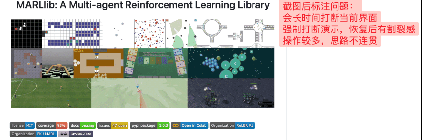
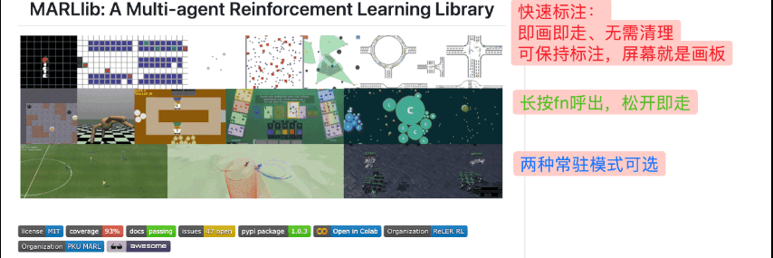
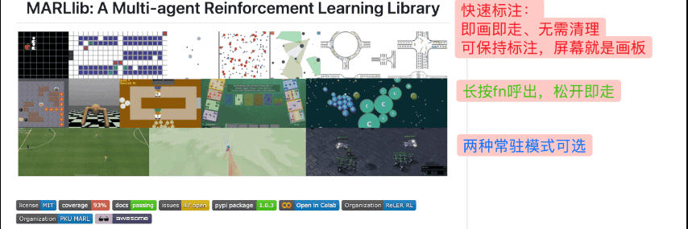

# Snow Shot · macOS Quick Annotation Fork

English · [简体中文](README.md)

This repository is a fork of [Snow Shot](https://github.com/mg-chao/snow-shot) with **Quick Annotation** for macOS. Draw a shape, arrow, or freehand mark directly over the current screen without taking a screenshot, for meetings, teaching, and presentations.

## Why this fork exists

I discussed Quick Annotation with the original maintainer. In my experience, they lacked the patience to understand the intended use cases and the already concise description of the requirements, and dismissed both my AI-assisted research and summaries and my own responses, making the discussion unproductive. You can read [the full discussion](https://github.com/mg-chao/snow-shot/issues/2494).
I therefore maintain this macOS version for my own use. Thanks to the original project and its contributors for the foundation.

This repository **only maintains macOS functionality related to Quick Annotation**. I do not have devices to validate or support Windows, other platforms, or unrelated feature requests. Others with the same need are welcome to use this fork.

## Demos

These recordings are shown in chronological order: the screenshot annotation issue, basic Quick Annotation, and persistent Quick Annotation.

### Screenshot annotation issue

### Quick Annotation basics

### Persistent Quick Annotation

## Download and use

Download the full macOS Apple Silicon DMG from this fork's [Releases](https://github.com/xiongxiao5795-jpg/snow-shot-dev/releases). For the original application and other platforms, see [upstream releases](https://github.com/mg-chao/snow-shot/releases); upstream does not include this fork's Quick Annotation.

- Press `Control+4` to start Quick Annotation, or hold `Fn` for temporary annotation. Change the bindings in **Settings → Global shortcuts → Quick annotation**.
- The default tool is a rounded rectangle. The toolbar also provides shapes, arrows, and freehand drawing with editable styles.
- Marks fade after a short delay by default. Toolbar options support continuous drawing with fading marks, or persistent marks with undo and redo.
- Configure colors, stroke width, hold and fade durations, and toolbar layout in **Settings → Quick annotation**.

Whether `Fn` conflicts with input switching or other system actions depends on macOS and keyboard settings. Grant the requested permissions when prompted. See the [fork maintenance notes](docs/fork-quick-annotation.md) for installation and signing details.

## Maintenance and licensing

Quick Annotation is disabled in ordinary builds and explicitly enabled in this fork's macOS Full DMG workflow. See the [maintenance notes](docs/fork-quick-annotation.md) for build and upstream-sync details, and the [upstream repository](https://github.com/mg-chao/snow-shot) for the original application's documentation.

This fork retains the licenses and copyright notices of the upstream components. The Snow Shot application is licensed under [GPL-3.0-or-later](snow_shot/COPYRIGHT).
